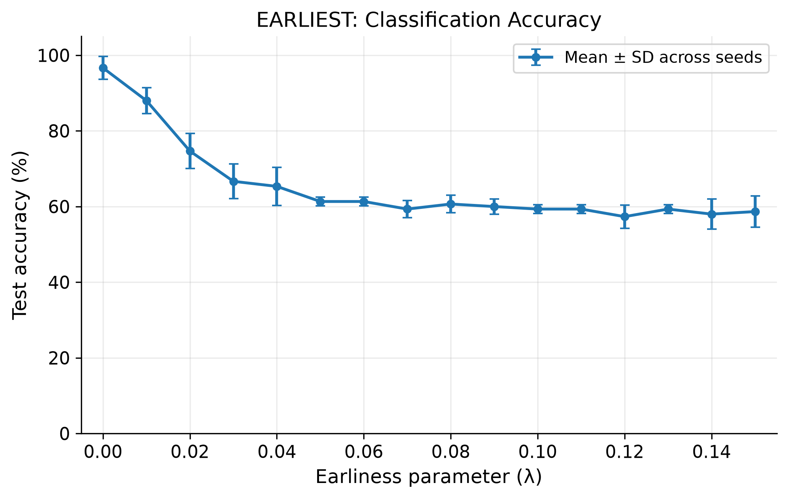
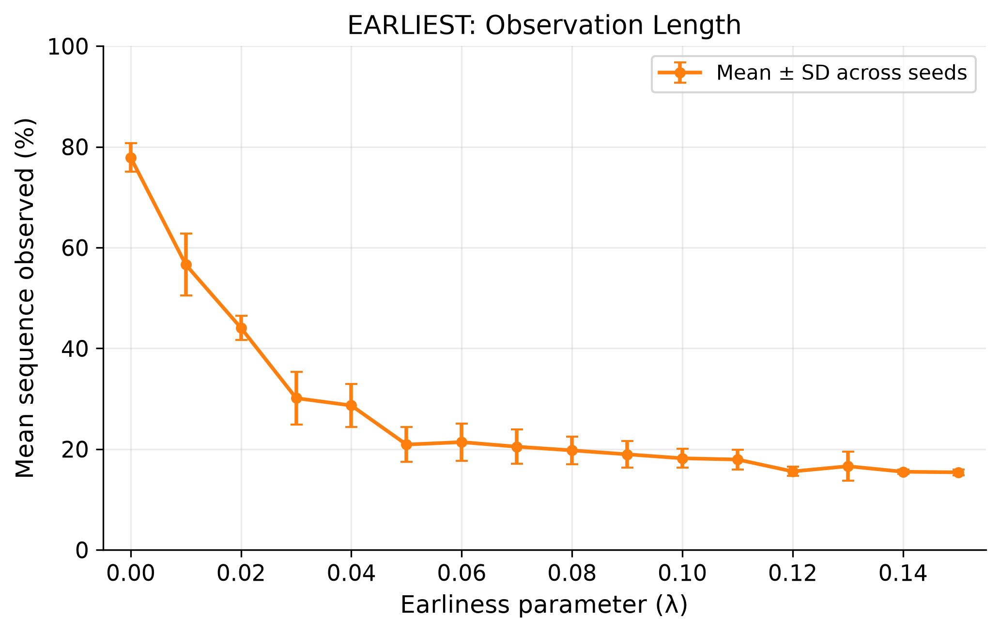
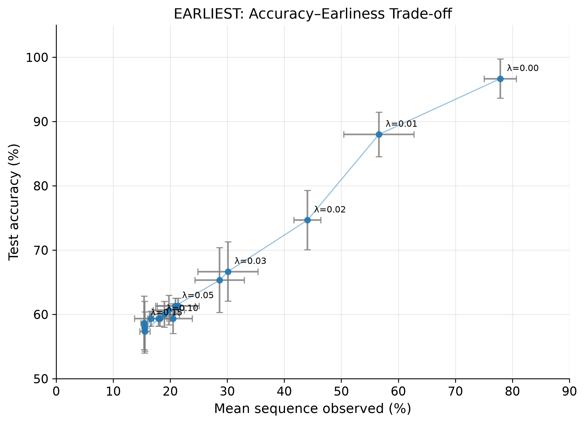
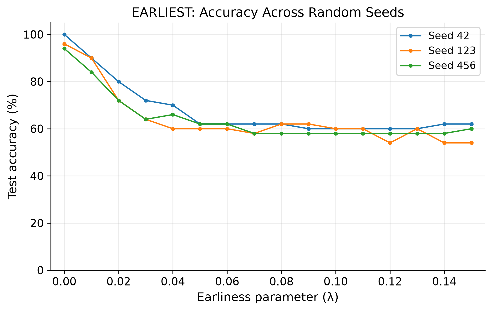

# Reproduction of EARLIEST on Synthetic Time-Series Data

**Project:** Signal-Quality-Aware Reinforcement Learning for Early Classification of Physiological Time Series

**Status:** Synthetic baseline completed; quantitative reproduction checks pending

## 1. Objective

The objective of this experiment was to reproduce the accuracy–earliness behaviour of EARLIEST (Early and Adaptive Recurrent Label ESTimator), introduced by Hartvigsen et al. (2019), using the authors' published implementation.

EARLIEST addresses early classification of time-series data by learning both a classification model and a reinforcement learning-based stopping policy. Rather than observing the entire sequence before predicting, the model attempts to determine when sufficient information has been acquired to make a reliable classification.

The initial reproduction focused on three questions:

1. How does increasing the earliness penalty $\lambda$ affect test classification accuracy?
2. How does $\lambda$ affect the average proportion of the input sequence observed before prediction?
3. How consistent is the learned accuracy–earliness trade-off across independent training runs?

The experiments also aimed to establish whether the behaviour observed in the original publication could be reproduced before extending EARLIEST to noisy physiological time-series data.

## 2. Background and Original Method

### 2.1 EARLIEST architecture

EARLIEST combines a recurrent neural network-based discriminator with a stochastic controller that learns when to terminate observation.

At each timestep, the recurrent network processes the available input and updates its internal representation. The controller uses this representation to determine whether to continue observing or to halt. When the controller halts, the discriminator produces the classification.

The stopping problem is formulated as a reinforcement learning task. The controller learns to balance the predictive value of additional observations against the objective of making decisions earlier.

### 2.2 Earliness penalty

The hyperparameter $\lambda$ controls the emphasis placed on early termination during learning.

Smaller values place less pressure on the controller to stop early, allowing the classifier to acquire more information. Larger values encourage earlier termination, potentially reducing classification performance if useful information has not yet been observed.

Importantly, $\lambda$ does not directly specify a stopping timestep. Instead, it influences the objective optimised by the learned stopping policy.

### 2.3 Original synthetic benchmark

Hartvigsen et al. (2019) evaluated EARLIEST using the SimpleSignal synthetic dataset, in which discriminative signals occur at known locations within a time series.

The original synthetic experiments investigated classification accuracy, average stopping time and the ability of EARLIEST to identify informative signal locations.

Figure 3 of the original paper presents the accuracy–earliness trade-off and the sensitivity of the model to $\lambda$.

The present experiment reproduces the lambda-sensitivity analysis using the repository's `synthetic` dataset option. Exact correspondence between the repository configuration used here and the published SimpleSignal setup remains to be verified.

## 3. Experimental Methodology

### 3.1 Implementation

The original EARLIEST implementation was used without intentional changes to its reinforcement learning architecture.

The experiment was conducted using Python 3.12 on Windows, with PyTorch used for model training and evaluation.

A custom experiment script, `scripts/synthetic_sweep.py`, was developed to automate repeated training and testing while keeping model checkpoints separate for each configuration.

The automation script invokes the original `train.py` and `test.py` entry points and extracts the reported testing accuracy and average proportion of sequence used.

**Implementation details to verify and record:**

- Exact upstream repository commit
- Installed PyTorch version
- Training epochs and batch size
- Model architecture and hidden dimensions
- Optimiser and learning rate
- Synthetic dataset size and generation procedure
- Training, validation and test split procedure
- Checkpoint selection and loading behaviour

These details are necessary for assessing numerical reproducibility relative to the original publication.

### 3.2 Experimental configurations

The earliness parameter was varied from 0.00 to 0.15 inclusive, using increments of 0.01.

For each lambda value, experiments were conducted with three random seeds:

- 42
- 123
- 456

This produced 16 lambda configurations and 48 completed training and testing runs.

Each run was assigned a separate checkpoint directory, and numerical results were recorded in `results/synthetic_baseline.csv`.

Training and testing outputs were additionally saved as individual text logs.

### 3.3 Evaluation metrics

Two primary metrics were recorded.

**Classification accuracy**

The proportion of correctly classified examples in the test set:

$$
\mathrm{Accuracy} =
\frac{N_{\mathrm{correct}}}{N_{\mathrm{test}}}
$$

Accuracy was converted to a percentage for reporting.

**Mean proportion observed**

The average proportion of each input sequence processed before the stopping policy terminates:

$$
P_{\mathrm{observed}} =
\frac{1}{N}\sum_{i=1}^{N}
\frac{\tau_i}{T_i}\times100
$$

Here, $\tau_i$ represents the stopping timestep of sequence $i$, and $T_i$ represents its total length.

Lower values indicate earlier classification.

For each lambda configuration, the arithmetic mean and sample standard deviation of the three recorded experimental results were calculated.

## 4. Experimental Results

### 4.1 Summary of representative results

The observed results demonstrate a clear trade-off between classification accuracy and early termination.

| $\lambda$ | Test accuracy (%) | Sequence observed (%) |
|---|---:|---:|
| 0.00 | 96.67 | 77.88 |
| 0.01 | 88.00 | 56.61 |
| 0.02 | 74.67 | 44.06 |
| 0.03 | 66.67 | 30.12 |
| 0.05 | 61.33 | 20.91 |
| 0.10 | 59.33 | 18.18 |
| 0.15 | 58.67 | 15.39 |

Values represent means across three random seeds. Complete run-level measurements and standard deviations are preserved in the results files.

### 4.2 Effect of lambda on classification accuracy

*Figure 1. Test classification accuracy as a function of the earliness parameter. Error bars represent sample standard deviations across three random seeds.*

At $\lambda=0$, the model achieved its highest mean test accuracy of 96.67%.

Increasing the earliness penalty reduced classification accuracy. At $\lambda=0.01$, the mean accuracy decreased to 88.00%, while at $\lambda=0.02$, it decreased further to 74.67%.

The largest deterioration occurred over the lower range of lambda values. Between $\lambda=0$ and $\lambda=0.05$, mean accuracy fell by 35.34 percentage points.

For larger lambda values, accuracy generally stabilised near 60%, with smaller fluctuations across configurations.

These findings suggest that strongly encouraging early termination can compromise classification performance.

### 4.3 Effect of lambda on observation length

*Figure 2. Mean proportion of sequence observed as a function of lambda. Error bars represent sample standard deviations across three random seeds.*

Increasing $\lambda$ generally reduced the proportion of each sequence processed before classification.

At $\lambda=0$, the model observed an average of 77.88% of the input sequence. Increasing lambda to 0.01 reduced sequence usage to 56.61%.

At $\lambda=0.05$, mean sequence usage was 20.91%, and at $\lambda=0.15$, it reached 15.39%.

The reduction in observation length was most pronounced over the lower lambda range. Beyond approximately 0.05, further increases in lambda produced smaller changes in the mean stopping position.

This indicates diminishing sensitivity of the observed stopping behaviour to the earliness penalty within the higher range of lambda values tested.

### 4.4 Accuracy–earliness trade-off

*Figure 3. Relationship between mean classification accuracy and mean proportion of sequence observed. Each operating point represents a lambda configuration, with error bars showing sample standard deviations across three random seeds.*

The accuracy–earliness curve demonstrates the competing objectives addressed by EARLIEST.

Configurations observing larger portions of the sequence generally achieved higher classification accuracy. Earlier predictions required accepting reduced predictive performance.

One potentially useful operating point was $\lambda=0.01$, for which the model achieved 88.00% mean accuracy while observing 56.61% of the sequence.

Relative to $\lambda=0$, this represents:

- An accuracy reduction of 8.67 percentage points.
- An observation-length reduction of 21.27 percentage points.
- A relative reduction in observation length of approximately 27.31%.

This setting is a useful candidate for subsequent investigation, but cannot be considered universally optimal without specifying the relative costs of incorrect and delayed predictions.

### 4.5 Variability across random seeds

*Figure 4. Classification accuracy across lambda configurations for seeds 42, 123 and 456.*

Although the overall accuracy–earliness relationship was consistent across the experiments, individual configurations exhibited variability.

For example, at $\lambda=0.01$, seeds 42 and 123 achieved 90% accuracy, while seed 456 achieved 84%.

This demonstrates the importance of evaluating stochastic training procedures across multiple random seeds rather than relying on a single experimental run.

However, three seeds provide only a limited estimate of variability. Additional repetitions would improve confidence in the stability of the results.

## 5. Comparison with Hartvigsen et al. (2019)

The original publication demonstrates that increasing the earliness penalty generally encourages EARLIEST to classify earlier, while reducing classification accuracy.

The present experiments reproduce this qualitative relationship.

The strongest agreement is observed in the overall direction of the trade-off: lower lambda values favour classification accuracy and longer observation, whereas higher values favour earlier decisions.

However, the present results show a comparatively pronounced plateau at higher lambda values. For lambda values above approximately 0.05, mean observation length varies relatively little, while accuracy remains substantially lower than at smaller lambda values.

This differs from the smoother lambda-dependent coverage of stopping times discussed in the original paper.

The original paper also evaluates several competing early-classification methods, whereas the present experiment evaluates only EARLIEST. Consequently, this reproduction cannot independently confirm the original claim of superiority over alternative methods.

Furthermore, the published experiments use five repetitions, compared with three seeds in the present study.

The results therefore support a qualitative reproduction of EARLIEST's expected behaviour, rather than an exact numerical replication of the original experimental findings.

## 6. Limitations

Several limitations must be considered.

**Limited random-seed coverage.** Only three seeds were evaluated per lambda configuration. This limits the reliability of estimated variability.

**Unverified configuration equivalence.** Exact correspondence between the original paper's experimental settings and those used in the present reproduction has not been fully established.

**No competing classification baselines.** The reproduction does not include fixed-time or confidence-based stopping methods, preventing direct verification of the comparative performance claims in the original paper.

**Aggregate stopping metrics.** Mean sequence usage does not reveal whether the policy stops immediately after observing discriminative signals or unnecessarily delays classification. Per-example stopping times would be required for this analysis.

**Synthetic data only.** The results do not establish generalisation to physiological recordings, where measurement noise, patient variability and signal artefacts may affect classification and stopping decisions.

## 7. Conclusions and Next Steps

The synthetic experiments successfully demonstrate the principal accuracy–earliness trade-off expected from EARLIEST.

Across 48 completed training and testing runs, increasing the earliness penalty generally produced earlier stopping decisions at the expense of classification accuracy.

The model achieved 96.67% mean accuracy while observing 77.88% of sequences at $\lambda=0$. At $\lambda=0.01$, it achieved 88.00% accuracy while observing 56.61% of sequences.

These findings establish an initial working baseline and provide a basis for evaluating the effects of modifying the stopping policy.

The next research stages are to verify the implementation against the published settings, establish a physiological dataset baseline, and investigate whether incorporating causally available signal-quality information improves early classification under noisy observation conditions.

The proposed contribution remains a hypothesis to be evaluated through controlled experiments using matched training conditions, multiple random seeds and identical test sets.

## 8. Reproducibility and Data Availability

The experiment outputs are organised as follows:

| File | Purpose |
|---|---|
| `scripts/synthetic_sweep.py` | Automated training and testing |
| `results/synthetic_baseline.csv` | Individual experimental measurements |
| `results/synthetic_summary.csv` | Aggregated means and standard deviations |
| `notebooks/syn_sweep_analysis.ipynb` | Numerical analysis and visualisation |
| `figures/` | Exported experimental figures |
| `saved_models/` | Locally retained model checkpoints |

Large training logs and model checkpoints are excluded from version control, while numerical results, scripts, figures and documentation are retained for reproducibility.

## References

Hartvigsen, T., Sen, C., Kong, X. and Rundensteiner, E. (2019). Adaptive-Halting Policy Network for Early Classification. *Proceedings of the 25th ACM SIGKDD International Conference on Knowledge Discovery & Data Mining*, pp. 101–110. https://doi.org/10.1145/3292500.3330974

Original implementation: https://github.com/Thartvigsen/EARLIEST